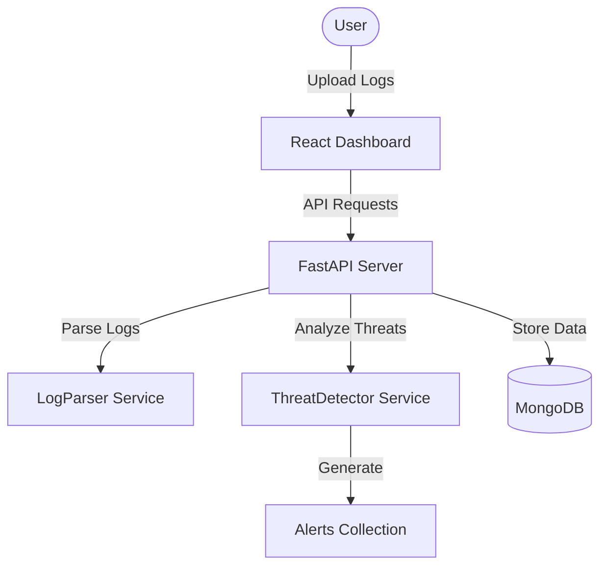

# Cybersecurity Log Analyzer (SentinelX)

SentinelX is a SIEM-style dashboard that detects suspicious login activity from server log files. It features a React frontend with Chart.js visualizations and a FastAPI backend with MongoDB storage.

## Features

- **Log Upload**: Upload server log files for processing.
- **Threat Detection**: 
  - Brute force detection (>5 failures in 1 minute).
  - Suspicious IP tracking (>20 total failures).
- **Real-time Dashboard**: Interactive stats and trend charts.
- **Visualizations**: Hourly activity trends using Chart.js.
- **Dark UI**: Premium SIEM-inspired interface.

## Tech Stack

- **Backend**: Python, FastAPI, Motor (Async MongoDB), Pydantic.
- **Frontend**: React, Vite, Chart.js, Tailwind CSS (via Lucide + custom CSS), Framer Motion.
- **Database**: MongoDB.

## Architecture



## Installation

### Prerequisites
- Python 3.9+
- Node.js 18+
- MongoDB running locally (or update `.env`)

### Backend Setup
1. Navigate to `backend/`.
2. Install dependencies:
   ```bash
   pip install -r requirements.txt
   ```
3. Run the server:
   ```bash
   python main.py
   ```

### Frontend Setup
1. Navigate to `frontend/`.
2. Install dependencies:
   ```bash
   npm install
   ```
3. Run the development server:
   ```bash
   npm run dev
   ```

## Usage
1. Open the dashboard (usually at `http://localhost:5173`).
2. Click **Upload Log** and select the provided `sample_logs.txt` (or any log file following the format).
3. Observe real-time stats, alerts, and charts updates.

## Project Structure
- `backend/`: API and services.
- `frontend/`: React application.
- `sample_logs.txt`: Provided for testing.

## Security

Please refer to [SECURITY.md](SECURITY.md) for security policy guidelines and threat detection rules.
